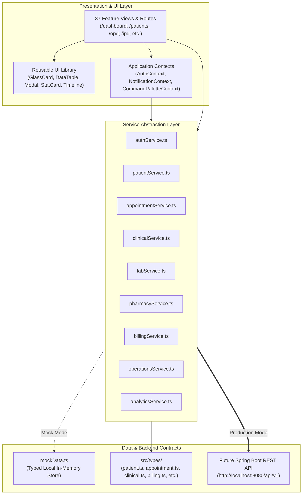

# MediCore HMS — Enterprise Hospital Management System

<div align="center">


[](https://react.dev/)
[](https://www.typescriptlang.org/)
[](https://vitejs.dev/)
[](https://tailwindcss.com/)
[](https://reactrouter.com/)
[](LICENSE)

*A next-generation, high-performance healthcare management platform engineered for tertiary care hospitals, multi-specialty clinics, and modern health systems.*

[Features](#-core-functional-modules) • [Architecture](#-system-architecture) • [Getting Started](#-quick-start) • [Backend Integration](#-spring-boot-backend-architecture--running-guide) • [Strategic Roadmap](SYSTEM_ROADMAP_AND_SUGGESTIONS.md) • [Design System](#-design-system--tokens)

</div>

---

## 🌟 Executive Overview

**MediCore HMS** is a Silicon Valley-grade hospital command center and electronic health record (EHR) platform. Designed with inspiration from modern enterprise software (Linear, Stripe, Apple Health, and Vercel), it balances a calm, dark glassmorphic design language with clinical precision, patient safety, and high operational throughput.

It provides complete end-to-end management across **37 dedicated modules** covering outpatient clinics, emergency trauma triage, inpatient ward bed tracking, computerized physician order entry (CPOE), pharmacy dispensing, diagnostic laboratory specimen tracking, radiology imaging workflows, insurance pre-authorizations, financial invoicing, and statutory reporting.

---

## 🛠️ Technology Stack

| Layer | Technology | Version | Purpose |
| :--- | :--- | :--- | :--- |
| **Core Framework** | [React](https://react.dev/) | `^19.2.0` | Declarative, component-driven UI architecture |
| **Type System** | [TypeScript](https://www.typescriptlang.org/) | `~6.0.0` | Strict type-safety with zero `any` tolerance |
| **Build Tooling** | [Vite](https://vitejs.dev/) | `^8.3.0` | Ultra-fast HMR and optimized asset bundling |
| **Styling Engine** | [Tailwind CSS](https://tailwindcss.com/) | `^3.4.17` | Utility-first styling with custom design tokens |
| **Routing** | [React Router DOM](https://reactrouter.com/) | `^7.0.0` | Client-side routing, protected routes, and layouts |
| **Async State** | [TanStack Query](https://tanstack.com/query) | `^5.0.0` | Server state management and future API caching |
| **Form Management** | [React Hook Form](https://react-hook-form.com/) | `^7.54.0` | Performant, uncontrolled form validation |
| **Schema Validation**| [Zod](https://zod.dev/) | `^3.24.0` | Runtime data validation and TypeScript inference |
| **Data Visualization**| [Recharts](https://recharts.org/) | `^2.15.0` | Minimalist dark analytics, area, bar, and pie charts |
| **Iconography** | [Lucide React](https://lucide.dev/) | `^1.16.0` | Clean, accessible medical and interface icons |

---

## 🏗️ System Architecture

The frontend follows a decoupled, service-oriented structure designed for seamless transition from the current mock service layer to a real **Spring Boot REST API** backend without touching the presentation components.



---

## 📦 Core Functional Modules

MediCore HMS is partitioned into 7 cohesive clinical and operational zones:

### 1. 🛡️ Authentication & Access Control
* **Route**: `/login`
* **Features**: Full-screen dark canvas with ambient glowing radial backdrops, centered glassmorphism card, password visibility toggle, "Remember Me" session tracking, 1-click **Demo Login**, and route guards with automatic login redirection.
* **Credentials**:
  * **Email**: `admin@medicore.com`
  * **Password**: `admin123`

### 2. 📊 Executive Command Center
* **Route**: `/dashboard`
* **Features**: 
  * 5 Real-time KPI Metric Cards: Total Patients (`1,248`), Today's Appointments (`186`), Active Inpatient Admissions (`42`), Bed Occupancy Rate (`78%`), and Gross Daily Revenue (`₹8.42L`).
  * 4 Recharts Analytics Panels: Patient Flow (OPD vs ER vs IPD), Revenue Velocity vs Daily Target, Bed Occupancy breakdown, and Department volume.
  * Live Outpatient Schedule, Bed Availability by critical ward, Actionable Operational Task list, and Real-time Activity Feed.

### 3. 👥 Patient Care & Master Patient Index (MPI)
* **Routes**: `/patients`, `/patients/new`, `/patients/:id`
* **Features**:
  * Searchable and filterable patient roster (by department, gender, and clinical status).
  * Multi-section registration form with **React Hook Form + Zod** schema validation (Personal, Contact, ABDM/ABHA digital identifiers, Next-of-Kin Emergency Contact, Medical Background, and Insurance Coverage) with demo auto-fill.
  * **Patient 360 Profile** (`/patients/:id`): Patient demographic banner, summary metrics, clinical history tabs (Overview, Longitudinal Timeline, Past Medical/Surgical History, Active Prescriptions, Lab Reports with abnormal flags, Radiology Scans, and Itemized Invoices).

### 4. 📅 Scheduling & Real-Time Hospital Queue
* **Routes**: `/appointments`, `/queue`
* **Features**:
  * Multi-view calendar (Day, Week, Month) with doctor, department, and status filters.
  * Appointment booking modal with live doctor availability slot selection.
  * Departmental queue system (OPD, Emergency, Lab, Radiology) with token paging, audio-visual calling, wait-time tracking, priority badges (Normal, Urgent, Emergency), and skip/complete transitions.

### 5. 🩺 Outpatient Department (OPD) & Physician Consultation
* **Routes**: `/opd`, `/opd/consultation/:id`
* **Features**:
  * Outpatient clinic dashboard with active chamber metrics.
  * **3-Column Clinical Workstation**:
    * **Left**: Patient biological profile, drug allergy warnings, and chronic illness history.
    * **Center**: Objective vitals charting (BP, Pulse, Temp, RR, SpO2, Weight, Height with automated BMI calculation), Chief Complaint, History of Present Illness (HPI), Physical Examination, and Provisional/ICD-10 Diagnosis.
    * **Right**: Multi-item Prescription Builder (Brand, Generic, Route, Frequency, Duration, Instructions), one-click Diagnostic Panel ordering (CBC, Lipid, Troponin, X-Ray, Echo), and Follow-up disposition.

### 6. 🏥 Inpatient (IPD) & Bed Management
* **Routes**: `/ipd`, `/ipd/beds`
* **Features**:
  * Inpatient admissions directory with attending consultants, expected lengths of stay, transfer protocols, and automated discharge processing.
  * **Visual Bed Management Layout**: Hierarchical navigation (Building -> Floor -> Ward -> Bed) with color-coded operational states (`Available`, `Occupied`, `Reserved`, `Cleaning`, `Maintenance`) and quick status management.

### 7. 🚨 Emergency & Resuscitation Center
* **Route**: `/emergency`
* **Features**:
  * Real-time Manchester triage board with color-coded urgency (`Critical` Red, `Urgent` Yellow, `Stable` Green).
  * Rapid bay allocation, immediate trauma vital signs monitoring, and direct fast-track clinical chart launches.

### 8. 🌐 Patient Digital Self-Service Portal
* **Routes**: `/portal/login`, `/portal/register`, `/portal/dashboard`
* **Features**:
  * **Online Patient Registration**: Direct self-onboarding generating live Medical Record Numbers (`MRN-XXXXX`) in PostgreSQL.
  * **Self-Service Appointment Booking**: Patients book visits with their chosen physician, department, and slot.
  * **Automated Queue Token & Pass**: Generates printable Appointment Passes with live Queue Token #, chamber room, and preparation notes.
  * **Personal Health Dashboard**: View active digital prescriptions, verified lab reports, itemized billing history, and upcoming visits.
  * **Dedicated Patient Notifications**: Instant alerts when appointments are confirmed, prescriptions are ready, or lab results are uploaded.

### 9. 🔔 Real-Time Hospital Notification Engine
* **Routes**: `/notifications` & Topbar quick-bell dropdown
* **Features**:
  * Dual-portal notification bell with pulsating unread counter and sound chime (via Web Audio API).
  * Filter alerts by category (**All**, **Clinical**, **Appointments**, **Billing**, **Pharmacy**, **System**) and priority (**Critical**, **Urgent**, **Normal**, **Low**).
  * **"Dispatch Live Alert" Modal**: Clinical staff can broadcast hospital-wide emergency or operational announcements instantly.
  * Backed by PostgreSQL `notifications` table and Spring Boot `/api/v1/notifications` REST API.

### 10. 🔬 Diagnostic Services (Laboratory & Radiology)
* **Routes**: `/laboratory`, `/radiology`
* **Features**:
  * Phlebotomy specimen tracking (`Pending Collection` -> `Sample Collected` -> `In Processing` -> `Verified`).
  * Automated Analyzer Report Viewer: Biological reference intervals with abnormal flags (`Low`, `High`, `Critical`) and digital pathologist sign-off.
  * Radiology PACS Modality Worklist: Digital X-Ray, CT, MRI 3.0T, and Ultrasound Doppler scheduling with radiologist impression authoring.

### 11. 💊 Pharmacy & Supply Inventory
* **Routes**: `/pharmacy`, `/inventory`
* **Features**:
  * Physician e-prescription dispensing queue with 1-click fulfillment.
  * Central Drug Formulary: Batch numbers, manufacturing and expiration dates, shelf locations, MRP tracking, and stock adjustments.
  * Hospital supply inventory: Surgical disposables, PPE, diagnostic reagents, and procurement purchase orders.

### 12. 💳 Financial Operations, Invoicing & TPA
* **Routes**: `/billing`, `/insurance`
* **Features**:
  * Revenue breakdown charts by department and payment method (UPI, POS Card, Cash, Cashless Insurance).
  * Printable GST Tax Invoices with itemized healthcare services, discounts, and payment status.
  * Cashier payment collection modal for instant balance clearance.
  * Insurance & TPA Claims tracker with pre-authorization clearance and claim dossiers.

### 13. 🚑 Operations, Blood Bank & Logistics
* **Routes**: `/ot`, `/blood-bank`, `/ambulance`, `/staff`
* **Features**:
  * **OT Complex**: Surgical suite scheduling, team rosters (Surgeon, Anesthetist, Scrub Nurse), and pre-op checklist verification.
  * **Blood Bank**: Inventory by ABO/Rh phenotype (`A+`, `A-`, `B+`, `B-`, `AB+`, `AB-`, `O+`, `O-`) with critical threshold alerts.
  * **Ambulance EMS**: Fleet vehicle status (`Available`, `On Trip`, `Maintenance`), crew contacts, fuel monitoring, and live GPS coordinates.
  * **Staff Roster**: Departmental shift scheduling and active on-duty tracking.

### 14. 📈 Insights, Security & System Administration
* **Routes**: `/reports`, `/analytics`, `/notifications`, `/settings`, `/settings/users`, `/settings/roles`, `/settings/audit-logs`
* **Features**:
  * Statutory reporting center with one-click PDF/CSV export simulation.
  * Deep analytics engine with timeframe filters (`Daily`, `Weekly`, `Monthly`, `Yearly`).
  * Notification center with category filtering (`Clinical`, `Appointments`, `Billing`, `Pharmacy`, `System`).
  * Institutional hospital profile editor (NABH licensing, emergency numbers, tax registration).
  * User accounts management with credential reset triggers.
  * **RBAC Permission Matrix**: Interactive granular toggles (`View`, `Create`, `Edit`, `Delete`) across all domains.
  * **Tamper-Evident Audit Ledger**: Cryptographically sealed activity logs with inspect drawer.

---

## 🎨 Design System & Tokens

MediCore HMS implements a custom design language: **Dark Silicon Valley SaaS + Glassmorphism + Technical Healthcare**.

### Color Palette

| Token | CSS Variable / Utility | Hex Value | Application |
| :--- | :--- | :--- | :--- |
| **Background Primary** | `--background` / `bg-[#05070A]` | `#05070A` | Deep obsidian base canvas |
| **Background Secondary**| `--background-secondary` | `#0A0D12` | Elevated containers, sidebar |
| **Surface** | `--surface` / `bg-[#0F131A]` | `#0F131A` | Cards, tables, forms, modals |
| **Surface Elevated** | `--surface-elevated` | `#141A24` | Table headers, dropdown menus |
| **Glass Background** | `--glass` | `rgba(255,255,255,0.055)` | Backdrop blur cards |
| **Glass Border** | `--border` | `rgba(255,255,255,0.08)` | Thin transparent structural borders |
| **Primary Accent** | `--primary` / `text-accent-primary` | `#5B8CFF` | Primary actions, links, active pills |
| **Secondary Accent** | `--secondary` | `#7C5CFF` | Digital cross motif, highlights |
| **Status Success** | `--success` / `text-status-success` | `#30D158` | Verified results, paid bills, normal flags |
| **Status Warning** | `--warning` / `text-status-warning` | `#FFB547` | Pending queues, review required, low stock |
| **Status Danger** | `--danger` / `text-status-danger` | `#FF5C70` | Critical ER triage, emergency, allergies |
| **Status Info** | `--info` / `text-status-info` | `#38BDF8` | Inpatient stays, general telemetry |
| **Text Primary** | `--text-primary` | `#F5F7FA` | Primary headings, titles, values |
| **Text Secondary** | `--text-secondary` | `#9AA4B2` | Body copy, table labels |
| **Text Muted** | `--text-muted` | `#687386` | Footers, hints, metadata |

### Ambient Lighting
```css
background: 
  radial-gradient(circle at 10% 10%, rgba(91, 140, 255, 0.12), transparent 30%),
  radial-gradient(circle at 90% 80%, rgba(124, 92, 255, 0.08), transparent 30%),
  #05070A;
```

---

## ⌨️ Global Shortcuts

| Shortcut | Action | Description |
| :--- | :--- | :--- |
| <kbd>Ctrl</kbd> + <kbd>K</kbd> / <kbd>⌘</kbd> + <kbd>K</kbd> | **Command Palette** | Opens search across patients, doctors, medicines, and invoices with quick action jump links |
| <kbd>ESC</kbd> | **Close Active Modal** | Dismisses any active dialog, command palette, or inspection drawer |

---

## 🚀 Quick Start

### ⚡ One-Click Full-Stack Launch (Recommended)
You can start PostgreSQL 16, Spring Boot 3.4.3 backend, and React 19 frontend simultaneously with a single command or double-click:

```bat
start-all.bat
```
*Automatically validates database health, boots the REST backend, serves the frontend on port 3000, and opens http://localhost:3000 in your default browser.*

To stop all services cleanly:
```bat
stop-all.bat
```

---

### Manual Setup & Execution

### Prerequisites
* **Node.js**: `v18.0.0` or higher (Tested on `v20.19.6`)
* **npm**: `v9.0.0` or higher (Tested on `v10.8.2`)
* **Java**: `OpenJDK 21 LTS` or higher
* **PostgreSQL**: `16.x` or higher

### 1. Clone the Repository
```bash
git clone https://github.com/your-org/medicore-hms.git
cd medicore-hms
```

### 2. Install Dependencies
```bash
npm install
```

### 3. Configure Environment Variables
Copy `.env.example` to `.env`:
```bash
cp .env.example .env
```
Default configuration:
```env
VITE_API_BASE_URL=http://localhost:8080/api/v1
VITE_ENABLE_MOCK_API=true
```

### 4. Run the Development Server
```bash
npm run dev
```
The application will start on:
👉 **`http://localhost:3000`**

### 5. Production Build & Verification
To test strict TypeScript compilation and create the optimized production bundle:
```bash
npm run build
```
Preview the production build locally:
```bash
npm run preview
```

---

## 📁 Project Directory Structure

```text
Project_1/
├── start-all.bat                    # One-click portable launcher (Postgres + Spring Boot + Vite)
├── stop-all.bat                     # Clean shutdown script for all services
├── backup-db.bat                    # Database backup script (pg_dump to SQL)
├── restore-db.bat                   # Database restore script
├── medicore_hms_backup.sql          # Seed & sample database export (PostgreSQL 16)
├── SYSTEM_ROADMAP_AND_SUGGESTIONS.md# Production roadmap, architecture blueprint & suggestions
├── .env.example                     # Environment template for frontend
├── package.json                     # Core frontend dependencies and scripts
├── tailwind.config.js               # Design tokens, shadows, glass utilities
├── vite.config.ts                   # Vite configuration (port 3000, host true, @ alias)
├── backend/                         # Spring Boot 3.4.3 Modular Monolith Backend
│   ├── pom.xml                      # Maven dependencies (Java 21, JPA, Flyway, Security)
│   ├── .env.example                 # Backend environment variable template
│   └── src/main/
│       ├── java/com/medicore/hms/   # 30 JPA Entities, Repositories, Services, REST Controllers
│       └── resources/
│           ├── application.yml      # Spring Boot configuration (HikariCP, JWT, CORS)
│           └── db/migration/        # Flyway schema migrations (V1__init through V10__notifications)
└── src/                             # React 19 Frontend Application
    ├── main.tsx                     # React application bootstrap
    ├── App.tsx                      # Master routing and provider tree (37 routes)
    ├── index.css                    # Tailwind layers, scrollbars, print rules
    ├── vite-env.d.ts                # Vite client type declarations
    ├── types/                       # Domain TypeScript interfaces
    │   ├── patient.ts               # Patient, MRN, Demographics, Timeline
    │   ├── appointment.ts           # Appointments, Doctors, Live Queue
    │   ├── clinical.ts              # Consultations, Vitals, Nursing, ER, OT
    │   ├── diagnostics.ts           # Lab orders, abnormal flags, Radiology scans
    │   ├── pharmacy.ts              # Medicine formulary, Dispensing, Inventory
    │   ├── billing.ts               # Invoices, Payments, Insurance claims
    │   ├── operations.ts            # Beds, Wards, Blood Bank, Ambulance, Staff
    │   └── system.ts                # Users, RBAC Permissions, Audit logs
    ├── context/                     # Global React state providers
    │   ├── AuthContext.tsx          # Login, logout, demo credentials, storage
    │   ├── NotificationContext.tsx  # Toast popups and notification inbox
    │   └── CommandPaletteContext.tsx# Ctrl+K global keyboard listener
    ├── services/                    # Service layer with REST API abstractions
    │   ├── mockData.ts              # High-fidelity realistic clinical dataset
    │   ├── authService.ts           # Authentication logic
    │   ├── patientService.ts        # Patient CRUD and timeline management
    │   ├── appointmentService.ts    # Scheduling and queue management
    │   ├── clinicalService.ts       # Consultations, vitals, nursing, ER, OT
    │   ├── labService.ts            # Laboratory reports and radiology scans
    │   ├── pharmacyService.ts       # Prescriptions and stock adjustments
    │   ├── billingService.ts        # Invoices, payments, and insurance claims
    │   ├── operationsService.ts     # Beds, blood bank, ambulance, staff, RBAC
    │   └── analyticsService.ts      # KPI metrics and Recharts aggregations
    ├── components/
    │   ├── layout/                  # Navigation and frame components
    │   │   ├── AppLayout.tsx        # Responsive layout shell with ambient backdrop
    │   │   ├── Sidebar.tsx          # Collapsible enterprise navigation menu
    │   │   ├── Topbar.tsx           # Breadcrumbs, notifications, profile menu
    │   │   ├── CommandPalette.tsx   # Ctrl+K universal quick search dialog
    │   │   ├── MediCoreLogo.tsx     # Vector medical cross & node logo
    │   │   └── ProtectedRoute.tsx   # Authentication route guard
    │   └── ui/                      # Reusable atom and molecule components
    │       ├── GlassCard.tsx        # Glassmorphic card container
    │       ├── Button.tsx           # Silicon Valley button with loading spinner
    │       ├── Input.tsx            # Styled dark input with label and validation
    │       ├── Select.tsx           # Custom select dropdown
    │       ├── Textarea.tsx         # Multiline text input
    │       ├── Badge.tsx            # Status indicator pill badge
    │       ├── StatusBadge.tsx      # Semantic domain status badge with dot
    │       ├── Modal.tsx            # Accessible dialog with blur backdrop
    │       ├── Drawer.tsx           # Slide-over panel for audit logs
    │       ├── Tabs.tsx             # Active pill navigation tabs
    │       ├── StatCard.tsx         # KPI card with trend indicators
    │       ├── Timeline.tsx         # Vertical clinical journey stream
    │       ├── DataTable.tsx        # Sortable, searchable, paginated table
    │       ├── SearchInput.tsx      # Search box with shortcut badge
    │       ├── Avatar.tsx           # User initials and image fallback avatar
    │       ├── EmptyState.tsx       # Polished empty result illustration
    │       └── Skeleton.tsx         # Dark pulsing loading placeholder
    └── pages/                       # Application Views
        ├── auth/                    # /login
        ├── dashboard/               # /dashboard
        ├── patients/                # /patients, /patients/new, /patients/:id
        ├── appointments/            # /appointments
        ├── queue/                   # /queue
        ├── doctors/                 # /doctors
        ├── opd/                     # /opd, /opd/consultation/:id
        ├── ipd/                     # /ipd, /ipd/beds
        ├── nursing/                 # /nursing
        ├── emergency/               # /emergency
        ├── emr/                     # /emr
        ├── laboratory/              # /laboratory, /laboratory/results
        ├── radiology/               # /radiology
        ├── pharmacy/                # /pharmacy, /pharmacy/inventory
        ├── inventory/               # /inventory
        ├── billing/                 # /billing, /billing/invoices, /billing/payments
        ├── insurance/               # /insurance
        ├── ot/                      # /ot
        ├── bloodbank/               # /blood-bank
        ├── ambulance/               # /ambulance
        ├── staff/                   # /staff
        ├── reports/                 # /reports
        ├── analytics/               # /analytics
        ├── notifications/           # /notifications
        └── settings/                # /settings, /settings/users, /settings/roles, /settings/audit-logs
```

---

## ☕ Spring Boot Backend Architecture & Running Guide

The backend for **MediCore HMS** is a production-grade, modular monolith built with **Spring Boot 3.4.3**, **Java 21 LTS**, **PostgreSQL 16**, and **Flyway**.

### Backend Technology Stack
* **Framework**: Spring Boot 3.4.3 (Java 21 LTS)
* **Database**: PostgreSQL 16.4 (`medicore_hms`)
* **Migrations**: Flyway (10 versioned migrations `V1__...` through `V10__...`)
* **Security**: Spring Security with JWT (HMAC-SHA512) & RBAC (`@PreAuthorize`)
* **ORM**: Spring Data JPA / Hibernate 6.6 with auditing
* **Documentation**: Springdoc OpenAPI / Swagger UI 3.0
* **Monitoring**: Spring Boot Actuator (`/actuator/health`, `/actuator/metrics`)

---

### Running the Full Stack Locally

#### 1. Backend Server (`http://localhost:8080`)
```powershell
# In Project_1/backend:
$env:JAVA_HOME = "$env:USERPROFILE\.tools\jdk21\jdk-21.0.12.1+1"
& "$env:JAVA_HOME\bin\java.exe" -jar target/medicore-hms-1.0.0-SNAPSHOT.jar
```
* **API Documentation (Swagger UI)**: [http://localhost:8080/swagger-ui/index.html](http://localhost:8080/swagger-ui/index.html)
* **OpenAPI 3.0 Specification**: [http://localhost:8080/v3/api-docs](http://localhost:8080/v3/api-docs)
* **Actuator Health Check**: [http://localhost:8080/actuator/health](http://localhost:8080/actuator/health)

#### 2. Frontend Application (`http://localhost:3000`)
```powershell
# In Project_1 (root):
npm run dev
```
* Access the web application at: 👉 **`http://localhost:3000`**

---

### Core REST API Endpoints

| Domain | Method | Endpoint | Description |
| :--- | :--- | :--- | :--- |
| **Auth** | `POST` | `/api/v1/auth/login` | Authenticate user, returns JWT tokens |
| **Auth** | `POST` | `/api/v1/auth/refresh` | Refresh expired access token |
| **Auth** | `GET` | `/api/v1/auth/me` | Current user profile |
| **Patients** | `GET` | `/api/v1/patients` | Paginated search (MRN, name, phone) |
| **Patients** | `POST` | `/api/v1/patients` | Register new patient |
| **Patients** | `GET` | `/api/v1/patients/{id}` | Patient profile by ID |
| **Appointments** | `GET` | `/api/v1/appointments` | Filter by date, doctor, or status |
| **Appointments** | `POST` | `/api/v1/appointments` | Book new appointment |
| **Queue** | `GET` | `/api/v1/queue` | Live OPD patient token queue |
| **Clinical** | `GET` | `/api/v1/clinical/patients/{id}/summary` | Aggregated EMR (vitals, notes, diagnoses, Rx) |
| **Clinical** | `POST` | `/api/v1/clinical/patients/{id}/vitals` | Record vital signs |
| **Clinical** | `POST` | `/api/v1/clinical/patients/{id}/notes` | Save clinical SOAP note |
| **Clinical** | `POST` | `/api/v1/clinical/patients/{id}/prescriptions` | Issue prescription |
| **Diagnostics** | `GET` | `/api/v1/laboratory/tests` | Available diagnostic lab tests catalog |
| **Diagnostics** | `POST` | `/api/v1/laboratory/orders` | Create diagnostic test order |
| **Diagnostics** | `POST` | `/api/v1/laboratory/orders/{id}/results` | Record verified lab result |
| **Pharmacy** | `GET` | `/api/v1/pharmacy/medicines` | Medication formulary catalog |
| **Pharmacy** | `POST` | `/api/v1/pharmacy/dispense` | Dispense prescription |
| **Inventory** | `GET` | `/api/v1/inventory` | Medical inventory stock list |
| **Inventory** | `GET` | `/api/v1/inventory/low-stock` | Low-stock items under threshold |
| **Billing** | `GET` | `/api/v1/billing/overview` | Total billed, collected, outstanding KPIs |
| **Billing** | `GET` | `/api/v1/billing/invoices` | Patient invoices |
| **Billing** | `POST` | `/api/v1/billing/invoices/{id}/payments` | Process payment |
| **IPD** | `GET` | `/api/v1/ipd/beds/stats` | Bed occupancy rate and total count |
| **IPD** | `POST` | `/api/v1/ipd/admissions` | Admit patient to bed/ward |
| **IPD** | `POST` | `/api/v1/ipd/admissions/{id}/discharge` | Discharge patient with summary |
| **Emergency** | `GET` | `/api/v1/emergency/triages` | Active emergency cases |
| **Emergency** | `POST` | `/api/v1/emergency/triages` | Triage acute emergency patient |
| **Analytics** | `GET` | `/api/v1/analytics/dashboard` | Executive KPI dashboard metrics |
| **Audit** | `GET` | `/api/v1/audit-logs` | HIPAA security audit trail |

---

### Demo Credentials

| Role | Email | Password | Access Level |
| :--- | :--- | :--- | :--- |
| **System Admin** | `admin@medicore.com` | `admin123` | Full administrative & clinical access |
| **Physician** | `doctor@medicore.com` | `admin123` | Appointments, EMR, prescriptions, orders |
| **Nurse** | `nurse@medicore.com` | `admin123` | Vitals, triage, IPD nursing, bed allocation |
| **Receptionist** | `reception@medicore.com` | `admin123` | Patient registration, queue check-in |

## 🔒 Security & Healthcare Compliance

* **Token Gating**: All clinical, administrative, and operational routes are guarded by `ProtectedRoute`.
* **Credential Hygiene**: No hardcoded API keys or sensitive health records are stored in browser storage.
* **ABDM Demo Standards**: ABHA identifiers and demographic fields are simulated for evaluation without exposing real personally identifiable information.
* **Auditability**: Security actions, clinical orders, and billing receipts emit structured event logs to the tamper-evident audit ledger.

---

## 📄 License

This project is licensed under proprietary terms for **MediCore Apex Health Systems**. Unauthorized copying, distribution, or commercial modification is strictly prohibited.

---

<div align="center">
  <sub>Engineered with care for clinicians, healthcare administrators, and patients.</sub><br/>
  <sub>MediCore HMS • Silicon Valley SaaS Frontend Architecture</sub>
</div>
