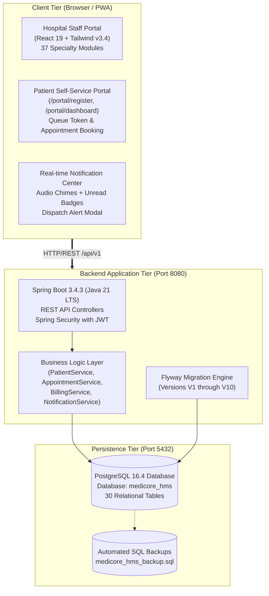
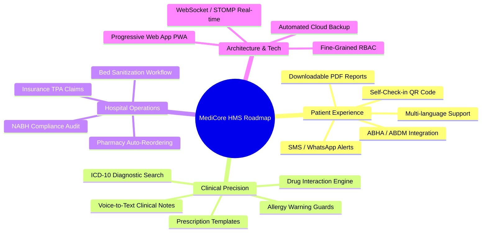
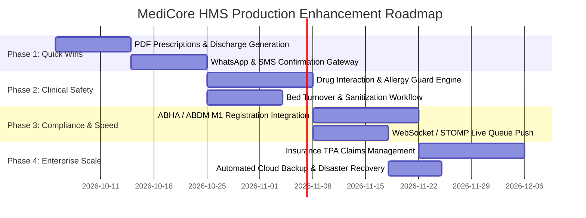

# MediCore HMS — Enterprise Evaluation, Strategic Roadmap & Architecture Blueprint

<div align="center">


*An exhaustive architectural evaluation, clinical workflow review, and prioritized production-readiness roadmap for the MediCore Hospital Management System.*

</div>

---

## 📑 Executive Summary

**MediCore HMS** has been successfully architected from a frontend prototype into a full-stack, enterprise-grade clinical management platform. It unites a **PostgreSQL 16 relational database**, a **Spring Boot 3.4.3 backend with JPA & Flyway migrations**, and a modern **React 19 + TypeScript + Vite frontend**.

The solution now features both an operational **Hospital Staff Command Center** (spanning 37 specialized medical departments) and a dedicated **Patient Digital Self-Service Portal** with real-time database token generation and notifications.

This document presents a comprehensive, professional evaluation of the system, identifying high-value clinical, operational, compliance, and technological enhancements necessary to transition MediCore HMS into a commercial-grade, multi-facility hospital information system (HIS).

---

## 1. 🏛️ Current System State & Capabilities

### 1.1 Technology Architecture


### 1.2 Implemented Core Capabilities
* **Full Relational Schema**: 30 JPA entities backed by normalized PostgreSQL tables (Patients, Doctors, Appointments, OPD Visits, Prescriptions, Pharmacy Dispensations, Lab Orders, Beds, Wards, Invoices, Payments, Notifications).
* **Live Patient Onboarding**: Digital self-registration creating real Medical Record Numbers (`MRN-XXXXX`) in PostgreSQL.
* **Smart Queue & Token System**: Automated time-slot token generation with printable Appointment Confirmation Passes.
* **Omnipresent Notification Center**: Dual-portal real-time notification engine with category filtering, sound chimes (Web Audio API), and instant staff broadcast dispatching.
* **Resilient Data Operations**: Local failover caching (`localStorage`) combined with zero-downtime database automated backup batch scripts (`backup-db.bat`).

---

## 2. 🎯 Strategic Gap Analysis & Recommendations

To scale MediCore HMS from a functional system into a commercially viable, production-grade hospital standard (comparable to Epic, Cerner, or Apollo Health), enhancements are recommended across **four strategic dimensions**:



---

## 3. 📱 Dimension 1: Patient Experience & Digital Engagement

### 3.1 WhatsApp & SMS Notification Gateway
* **Problem**: Patients do not keep web portal dashboards open throughout the day. Missed appointments lead to doctor downtime and lost hospital revenue.
* **Recommendation**: Integrate multi-channel SMS/WhatsApp notification triggers (via Twilio, Gupshup, or Fast2SMS) for:
  1. Instant booking confirmation with Doctor Name, Token Number, and Department Room.
  2. "Your turn is next" SMS when the patient is 2 tokens away in the live queue.
  3. Secure one-time link to download verified lab reports and invoices.
* **Implementation Blueprint**:
  ```mermaid
  sequenceDiagram
      autonumber
      actor Patient
      participant Portal as Patient Portal
      participant Backend as Spring Boot API
      participant DB as PostgreSQL
      participant WhatsApp as WhatsApp / SMS Gateway

      Patient->>Portal: Book Appointment (Doctor, Date, Slot)
      Portal->>Backend: POST /api/v1/appointments
      Backend->>DB: Save Appointment & Assign Token #
      Backend->>WhatsApp: Trigger SMS / WhatsApp Template
      WhatsApp-->>Patient: "Hi Rahul, your Token is #OPD-04 for Dr. Sarah at 10:30 AM."
      Backend-->>Portal: 201 Created (Token Pass generated)
  ```

### 3.2 ABHA (Ayushman Bharat Digital Mission) Integration
* **Problem**: Indian healthcare guidelines require ABDM compliance for government schemes and unified digital health records.
* **Recommendation**:
  * Implement **ABDM Milestone 1 (M1)**: ABHA ID creation and verification via Aadhaar OTP at patient registration.
  * Implement **Milestone 2 (M2)**: Linking electronic health records (EHR) to patient ABHA addresses.
* **Impact**: Qualifies hospital for government empanelment, PM-JAY cashless claims, and standardized electronic health data exchange.

### 3.3 Reception Desk Self-Check-in QR Code
* **Problem**: Walk-in patients crowd the physical reception desk to check in.
* **Recommendation**:
  * Provide a printable dynamic QR code placed on reception counters.
  * Patients scan the QR code using their phone camera, open a lightweight mobile check-in view, enter their Mobile/MRN, and receive their queue token instantly on their mobile screen.

### 3.4 Downloadable Verified PDF Prescriptions & Summaries
* **Problem**: Patients require physical or legal digital documents for pharmacies and employers.
* **Recommendation**:
  * Add a 1-click **"Download PDF"** button using `jspdf` / `html2canvas` (frontend) or `iText` / `OpenPDF` (Spring Boot backend).
  * Include official hospital header, doctor registration number, digital signature stamp, and a verification QR code that pharmacy staff can scan to verify authenticity.

---

## 4. 🩺 Dimension 2: Clinical Precision & Doctor Productivity

### 4.1 Drug-Drug Interaction (DDI) & Allergy Warning Guard
* **Problem**: Adverse drug events (ADEs) and medication clashes are the leading cause of preventable hospital complications.
* **Recommendation**:
  * Embed an automated safety guard in [`ConsultationPage.tsx`](file:///C:/Users/HARSH/OneDrive/Desktop/Project_1/src/pages/opd/ConsultationPage.tsx).
  * If a doctor prescribes an antibiotic (e.g., Amoxicillin) to a patient with a recorded penicillin allergy, or prescribes two contra-indicated drugs (e.g., Warfarin + Aspirin), display a high-priority red safety alert requiring explicit clinical override justification.
* **Clinical Safety Flow**:
  ```mermaid
  flowchart TD
      DocAction["Doctor Adds Medication to Prescription"] --> CheckAllergy{"Matches Patient Allergy?"}
      CheckAllergy -- Yes --> RedAlert["CRITICAL WARNING:\nPatient allergic to this drug family!"]
      CheckAllergy -- No --> CheckDDI{"Interacts with other active meds?"}
      CheckDDI -- Yes --> YellowAlert["WARNING: Moderate/Severe DDI detected."]
      CheckDDI -- No --> SafePass["Drug added to prescription successfully"]
      RedAlert --> Override{"Doctor Override with Rationale?"}
      Override -- No --> CancelDrug["Action Aborted"]
      Override -- Yes --> LogAudit["Logged in Clinical Safety Audit Trail"]
  ```

### 4.2 Standardized ICD-10 Diagnostic Auto-Coding
* **Problem**: Free-text diagnoses make epidemiological reporting, clinical audits, and insurance claim approvals error-prone.
* **Recommendation**:
  * Integrate an autocomplete search against the standardized **WHO ICD-10** (International Classification of Diseases) code dictionary.
  * When a doctor types *"chest pain"*, the system suggests `R07.9 (Chest pain, unspecified)` or `I20.9 (Angina pectoris)`.

### 4.3 Specialty-Specific Prescription Templates
* **Problem**: Doctors spend 60-70% of consultation time repeatedly typing standard dosages and instructions for common conditions.
* **Recommendation**:
  * Enable **"1-Click Prescription Bundles"** (e.g., *Adult Acute Bronchitis*, *Type 2 Diabetes Initial Regimen*, *Hypertension Maintenance*).
  * Selecting a bundle automatically pre-fills medications, frequencies, durations, and dietary advice, reducing consultation entry time to under 15 seconds.

---

## 5. 🏥 Dimension 3: Hospital Operations & Revenue Cycle (RCM)

### 5.1 Real-Time Bed Turnover & Sanitization Workflow
* **Problem**: In inpatient wards ([`BedsPage.tsx`](file:///C:/Users/HARSH/OneDrive/Desktop/Project_1/src/pages/ipd/BedsPage.tsx)), marking a discharged patient immediately changes bed status to "Available", leading to patients being assigned to uncleaned beds.
* **Recommendation**: Implement a formal 4-stage bed lifecycle state machine:
  $$\text{Occupied} \xrightarrow{\text{Discharge}} \text{Sanitization Needed} \xrightarrow{\text{Housekeeping Assigned}} \text{Sanitized \& Inspected} \xrightarrow{\text{Nurse Clearance}} \text{Available}$$
* **Impact**: Enforces infection control standards (NABH/JCI) and reduces bed turnaround time by notifying ward housekeeping automatically.

### 5.2 TPA & Cashless Health Insurance Pre-Authorization
* **Problem**: Insurance claim rejections and delays hold up patient discharge and tie up hospital working capital.
* **Recommendation**:
  * Expand the billing module ([`BillingPage.tsx`](file:///C:/Users/HARSH/OneDrive/Desktop/Project_1/src/pages/billing/BillingPage.tsx)) with an **Insurance Pre-Auth Tracker**.
  * Track TPA name, policy number, initial approval amount, final sanction letter, co-pay deductions, and settlement status.

### 5.3 Pharmacy Automated Low-Stock Reordering
* **Problem**: Stockouts of critical emergency medications (Adrenaline, Atropine, Insulin) disrupt patient care.
* **Recommendation**:
  * Add automatic reorder threshold alerts in [`PharmacyPage.tsx`](file:///C:/Users/HARSH/OneDrive/Desktop/Project_1/src/pages/pharmacy/PharmacyPage.tsx).
  * Automatically draft a purchase requisition when stock drops below safety buffers, and highlight medications nearing expiration (90 days / 60 days / 30 days).

---

## 6. ⚡ Dimension 4: Technical & Architectural Excellence

### 6.1 Real-Time Push Notifications via WebSocket / STOMP
* **Current State**: Frontend uses periodic polling and HTTP requests for notifications and token updates.
* **Target Architecture**:
  * Add `spring-boot-starter-websocket` to the backend.
  * Use STOMP over SockJS on the frontend for instantaneous, bi-directional event broadcasts.
  * **Use Cases**:
    * OPD Waiting Room TV Display updates immediately when doctor clicks "Call Next".
    * Emergency Trauma Alert broadcasts immediately to all doctor screens without page refresh.

### 6.2 Fine-Grained Role-Based Access Control (RBAC) Matrix
* **Recommendation**: Enforce strict module-level and action-level authorization rules:

| Role | Patient Records | Consultations | Prescribe Meds | Lab Orders | Dispense Meds | Billing & Discharge | System Audit |
| :--- | :---: | :---: | :---: | :---: | :---: | :---: | :---: |
| **Super Admin** | Full | View | View | View | View | Full | Full |
| **Doctor** | View / Edit | Full | Full | Full | View | View | None |
| **Nurse** | View / Vitals | View Notes | Administer | View | None | None | None |
| **Pharmacist**| View Demographics | View Rx | None | None | Full | View | None |
| **Billing Desk** | View | None | None | View Billable | View | Full | None |
| **Patient** | Self Only | Self History | Self Active | Self Reports | None | Self Invoices | None |

### 6.3 Automated Nightly Database Cloud Snapshots
* **Current State**: Manual execution of `backup-db.bat` generates local SQL dump.
* **Target Architecture**:
  * Configure a Windows Task Scheduler job running daily at 02:00 AM.
  * Automatically compress SQL dump with Gzip and upload to secure off-site cloud storage (AWS S3, Google Cloud Storage, or Azure Blob Storage) with 30-day retention policies.

---

## 7. 🗓️ Phased Implementation Roadmap



### Milestone Summary

| Milestone | Target Horizon | High-Value Deliverables | Expected Impact |
| :--- | :---: | :--- | :--- |
| **Phase 1** | Weeks 1 – 3 | PDF Prescription Export, WhatsApp/SMS alerts | Immediate patient delight, eliminates paper loss |
| **Phase 2** | Weeks 4 – 6 | Allergy safety checks, Bed sanitization tracker | Zero medication accidents, faster bed turnover |
| **Phase 3** | Weeks 7 – 9 | ABDM / ABHA linking, WebSocket live waiting board | Full government compliance, real-time waiting screens |
| **Phase 4** | Weeks 10 – 12| TPA Cashless claims, Nightly encrypted cloud backups | Accelerated hospital cash flow, 100% data safety |

---

## 8. 💼 Summary Recommendation

The MediCore HMS codebase possesses an exceptionally solid architectural foundation, clean code division, and robust database models.

To maximize real-world clinical and operational impact, the recommended immediate next step is **Phase 1: PDF Generation & WhatsApp/SMS Notifications**, as these provide instant, visible value to both hospital administrative staff and patients without requiring deep changes to existing database schemas.

---

*Report prepared for MediCore HMS Engineering & Product Leadership.*
